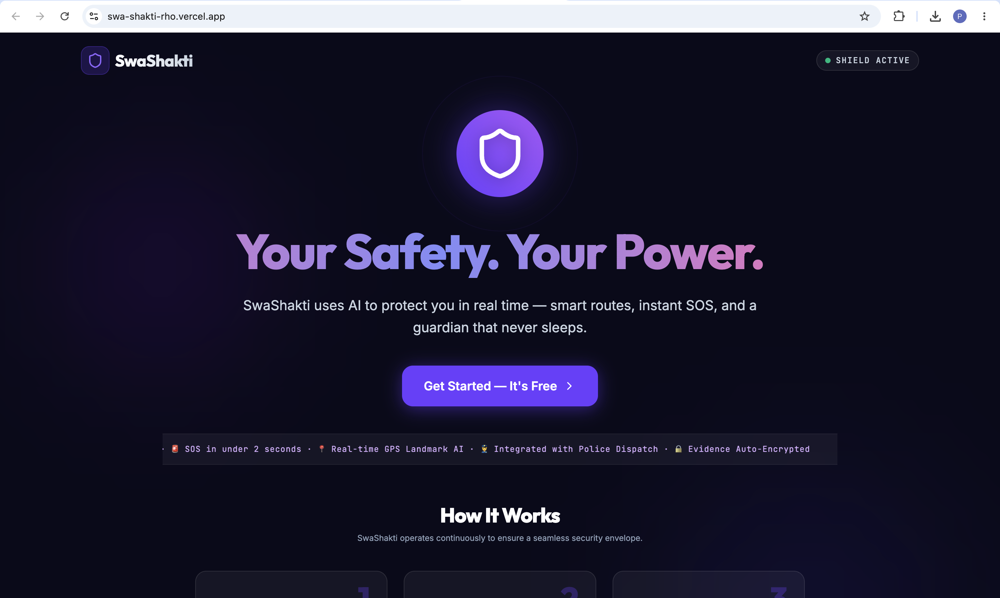
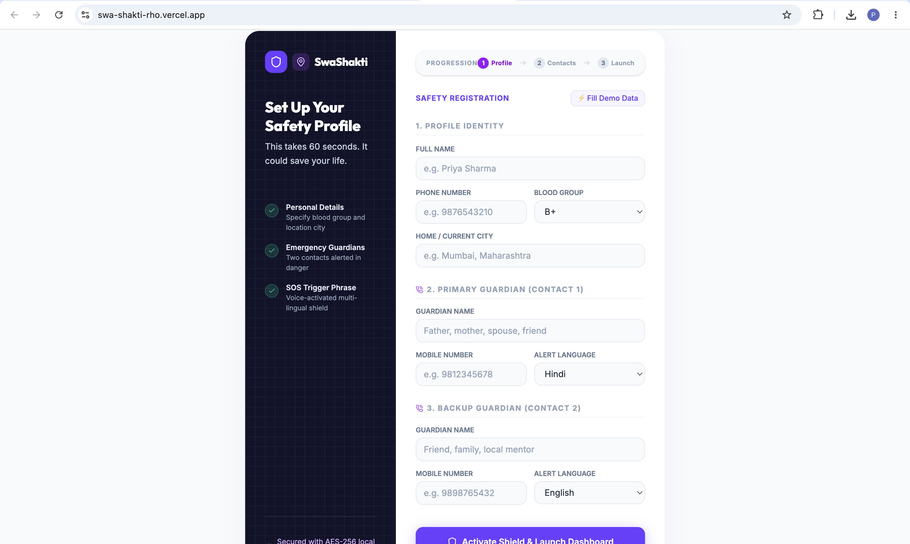
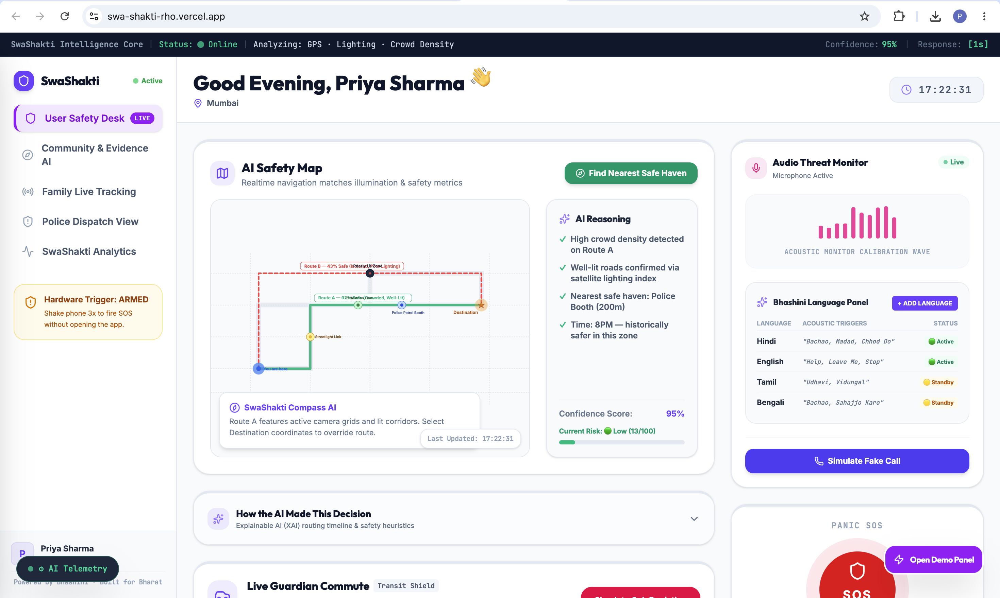
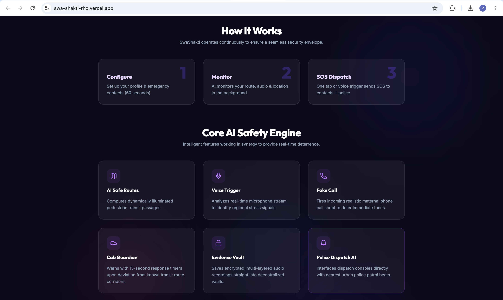
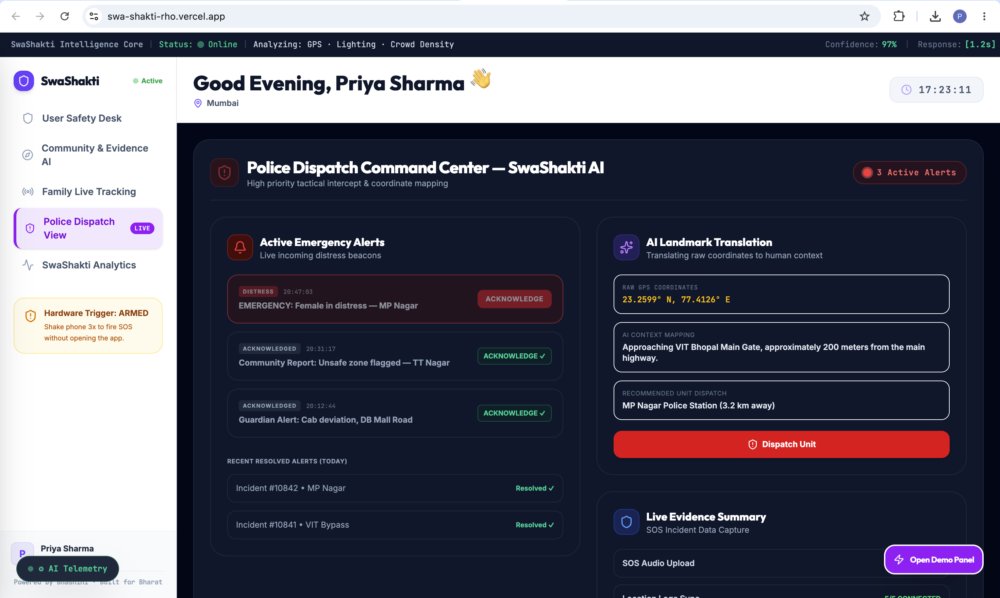
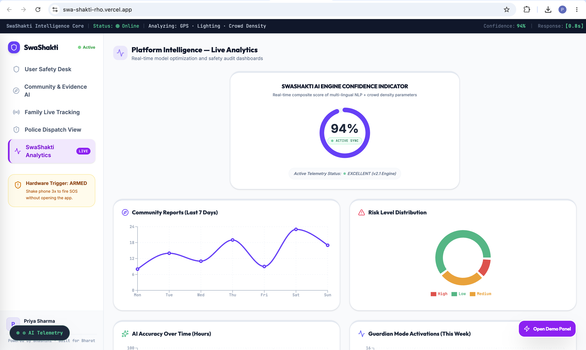

# 🛡️ SwaShakti
### AI-Powered Women's Safety Operating System


> **Empowering Every Journey with Intelligent Safety.**

SwaShakti is a full-stack women's safety platform designed to provide proactive protection, real-time emergency response, secure evidence collection, and community-driven safety intelligence.

Built as part of **Build for Good 2026**, SwaShakti combines modern web technologies with geospatial intelligence and AI-driven concepts to help users stay safer before, during, and after emergencies.

---

# 🌐 Live Demo

### 🚀 Frontend
https://swa-shakti-rho.vercel.app

### ⚙️ Backend API
https://swa-shakti.onrender.com

### ❤️ Health Check
https://swa-shakti.onrender.com/health

---

# 🌟 Problem Statement

Traditional emergency applications only become useful **after** an emergency begins.

During critical situations users often need to:

- Unlock their phone
- Call emergency contacts
- Share their live location
- Explain their surroundings
- Wait for assistance

These extra steps consume valuable time.

SwaShakti aims to reduce response time by combining emergency response, live tracking, secure evidence collection, and community safety intelligence into one platform.

---

# 💡 Our Solution

SwaShakti is an AI-inspired safety platform that combines emergency response, live tracking, secure evidence collection, and community intelligence into a unified safety ecosystem.

The platform focuses on reducing emergency response time while laying the foundation for intelligent, AI-assisted safety recommendations in future versions.

---

# 🌍 Why SwaShakti?

Unlike conventional emergency applications that react only after an incident occurs, SwaShakti aims to proactively improve user safety through real-time monitoring, community intelligence, secure evidence collection, and a roadmap toward AI-assisted decision making.

Our vision is to transform women's safety from a reactive process into a proactive ecosystem.

---

# ✅ Implemented Features

## 🚨 Smart SOS
- One-tap emergency activation
- Live GPS location capture
- Active SOS session management
- Emergency contact notification workflow

---

## 📍 Live Location Tracking
- Real-time location updates
- Socket.IO communication
- Live location broadcasting
- Continuous location monitoring

---

## 👨‍👩‍👧 Emergency Contacts
- Add multiple emergency contacts
- Guardian information management
- Secure PostgreSQL storage
- Quick SOS integration

---

## 🎤 Secure Evidence Vault
- Upload image, audio and video evidence
- Cloudinary secure storage
- Evidence linked to active SOS
- Timestamped evidence records
- PostgreSQL integration

---

## 🔥 Community Safety Dashboard
- Community hazard reporting
- Dynamic risk heatmap
- Community intelligence cards
- AI insight panel
- Risk visualization dashboard

---

## 📊 Analytics Dashboard
- Community report statistics
- Risk overview
- Guardian activity metrics
- Safety analytics visualizations

---

## 🔐 Authentication & Security
- User Registration
- Login
- JWT Authentication
- Protected APIs
- Firebase Cloud Messaging integration

---

## ☁️ Cloud & Infrastructure

- PostgreSQL hosted on Neon
- Secure media storage with Cloudinary
- Firebase Cloud Messaging
- Prisma ORM

---

## 🌍 Deployment

- Live frontend deployed on Vercel
- Backend deployed on Render

---

## 🔄 Real-Time Communication

- Socket.IO powered live communication
- Real-time SOS status updates
- Live location broadcasting

---

# 🧠 AI Roadmap

SwaShakti has been architected with an AI-first vision. While the current release focuses on the core emergency response ecosystem, the following intelligent capabilities are planned for future iterations:

- 🧠 AI Safety Score Engine
- 🗺️ Dynamic Safe Route Recommendation
- 🎙️ Distress Voice Recognition
- 📍 GPS-to-Landmark Translation
- 🚖 Route Deviation Detection
- 🔥 Community Risk Prediction
- 🌍 Bhashini Multilingual Integration
- 📞 AI Fake Call Generation
- 📊 Predictive Safety Analytics

These features represent the long-term roadmap of SwaShakti and are not fully implemented in the current release.
The current version focuses on delivering a robust emergency response platform while establishing the architectural foundation for future AI-powered safety capabilities.

---

# 🏗️ Tech Stack

## Frontend

- React
- TypeScript
- Vite
- Tailwind CSS
- React Leaflet
- Recharts
- Framer Motion
- Socket.IO Client

---

## Backend

- Node.js
- Express.js
- Prisma ORM
- Socket.IO
- JWT Authentication
- Multer
- Cloudinary

---

## Database

- PostgreSQL (Neon)

---

## Cloud Services

- Firebase Cloud Messaging
- Cloudinary

---

## Deployment

- Vercel
- Render

---

# 🔄 System Workflow

```text
User Authentication
        │
Emergency Contacts Setup
        │
Journey Monitoring
        │
Real-Time Location Tracking
        │
Community Intelligence Monitoring
        │
Emergency Trigger
        │
SOS Created
        │
Evidence Collection
        │
Emergency Contacts Notified
        │
Live Tracking
        │
Dashboard Updated
```

---

# 📊 Project Status

| Feature | Status |
|---------|--------|
| Authentication | ✅ Completed |
| Emergency Contacts | ✅ Completed |
| Smart SOS | ✅ Completed |
| Live GPS Tracking | ✅ Completed |
| Socket.IO Integration | ✅ Completed |
| Evidence Vault | ✅ Completed |
| Community Dashboard | ✅ Completed |
| Analytics Dashboard | ✅ Completed |
| Cloud Deployment | ✅ Completed |
| AI Safety Score Engine | 🚧 Planned |
| Voice Detection | 🚧 Planned |
| Safe Route Recommendation | 🚧 Planned |
| Bhashini Integration | 🚧 Planned |
| Hardware SOS Trigger | 🚧 Planned |

---

# 🚀 Future Enhancements

SwaShakti is designed to evolve into a comprehensive AI-powered safety ecosystem.

### 🤖 AI Features

- AI Safety Score Engine
- Explainable AI Route Planning
- Voice Activated SOS
- Automatic Distress Detection
- Smartwatch Integration
- Offline SOS Mode
- Hardware Emergency Trigger
- AI Landmark Detection
- Predictive Route Risk Analysis
- Community Crime Prediction
- Smart City Integration

---

### 💳 SwaShakti Plus (Future)

To ensure that all life-saving emergency services remain free, SwaShakti may introduce an optional premium subscription (**starting from ₹1/day or an affordable monthly subscription, focused on education, preparedness, and advanced AI-powered safety insights while ensuring all emergency services remain completely free.**) to support continuous platform development.

Premium features could include:

- 📚 Personalized women's safety learning modules
- 🥋 Self-defense video tutorials by certified trainers
- 🧠 AI-powered personalized safety recommendations
- 📍 Location-specific travel advisories
- 🚨 Weekly alerts for newly reported unsafe areas
- 🧾 Digital emergency preparedness checklists
- 👩‍⚕️ Mental health and legal support resources
- 🎁 Community contributor rewards and badges

> **Core emergency features—including SOS, live tracking, emergency contacts, and evidence storage—will always remain free for every user.**

---

# 📸 Application Preview

## 🚀 Landing Page



---

## 📝 Safety Registration



---

## 🛡️ User Dashboard



---

## 🧠 AI Safety Engine (Prototype UI)



---

## 🚔 Police Dashboard (Prototype UI)



---

## 📊 Analytics Dashboard



---

# 📂 Project Structure

```
Frontend
├── React
├── TypeScript
├── Components
├── Hooks
├── Services
└── Assets

Backend
├── Express
├── Prisma
├── Routes
├── Controllers
├── Services
├── Middleware
└── Socket.IO
```

---

# ⚙️ Local Setup

## Clone Repository

```bash
git clone https://github.com/pari-28/SwaShakti.git

cd SwaShakti
```

---

## Install Frontend

```bash
npm install
```

---

## Install Backend

```bash
cd backend
npm install
```

---

## Environment Variables

### Frontend (.env)

```env
VITE_API_URL=http://localhost:5001

VITE_FIREBASE_API_KEY=

VITE_FIREBASE_AUTH_DOMAIN=

VITE_FIREBASE_PROJECT_ID=

VITE_FIREBASE_STORAGE_BUCKET=

VITE_FIREBASE_MESSAGING_SENDER_ID=

VITE_FIREBASE_APP_ID=

VITE_FIREBASE_VAPID_KEY=
```

---

### Backend (.env)

```env
DATABASE_URL=

JWT_SECRET=

PORT=5001

CLOUDINARY_CLOUD_NAME=

CLOUDINARY_API_KEY=

CLOUDINARY_API_SECRET=

FIREBASE_PROJECT_ID=

FIREBASE_CLIENT_EMAIL=

FIREBASE_PRIVATE_KEY=
```

---

## Start Backend

```bash
cd backend

npm install

npm start
```

---

## Run Frontend

```bash
npm install
npm run dev
```

## Run Backend

```bash
cd backend
npm install
npm start
```

---

# 🏛️ Architecture

```text
                    Frontend (React + Vite)
                             │
                     REST APIs + Socket.IO
                             │
                    Express.js Backend
                             │
      ┌──────────────┬───────────────┬───────────────┐
      │              │               │
 PostgreSQL      Cloudinary      Firebase FCM
    (Neon)        Evidence       Push Notifications
```

---

# 🔌 API Overview

| Method | Endpoint | Description |
|---------|----------|-------------|
| POST | /api/auth/register | Register a new user |
| POST | /api/auth/login | User login |
| GET | /api/user/profile | Get user profile |
| POST | /api/sos | Create SOS alert |
| GET | /api/sos/active | Get active SOS |
| PATCH | /api/sos/:id/status | Update SOS status |
| POST | /api/evidence/upload | Upload emergency evidence |
| GET | /api/evidence/:sosId | Fetch evidence |
```

---

# 👩‍💻 Team

### Team SwaShakti

**Build for Good 2026**

- Pari Sangamnerkar
- Yash Shivnani

---

Built with ❤️ for Build for Good 2026.

Our mission is to leverage technology, real-time communication, and future AI innovations to make everyday travel safer and more confident for women.

---

# 📄 License

This project was developed as part of **Build for Good 2026** for educational and social impact purposes.

---

## ⭐ Acknowledgements

Special thanks to the **Build for Good 2026** organizers, mentors, and the open-source community for providing the tools and inspiration to build impactful technology.

---

## 📌 Project Status

✅ Active Development

🚀 Build for Good 2026 Submission

🌍 Deployed on Vercel & Render

🔮 AI-first Roadmap